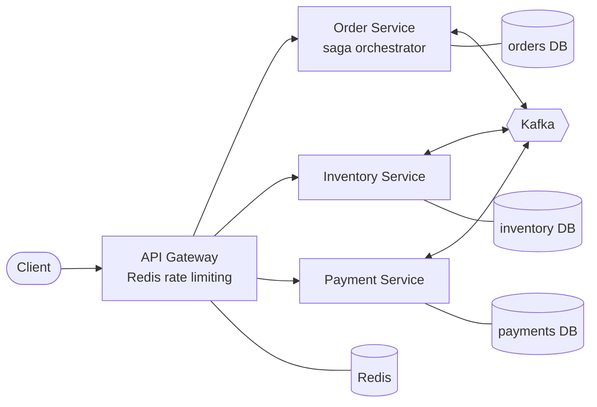
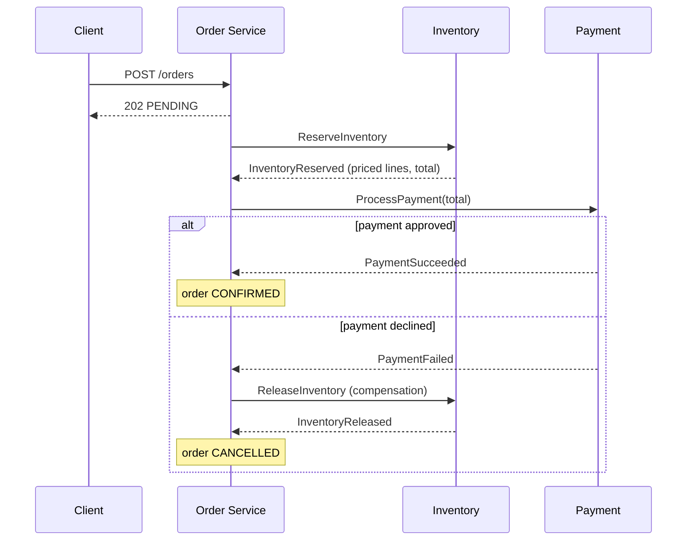

# Event-Driven Order Orchestrator

[](https://github.com/pavanprudhvi02/event-driven-order-orchestrator/actions/workflows/ci.yml)

An e-commerce backend split into Order, Inventory and Payment services, each with its own PostgreSQL database. Placing an order touches all three, and there is no shared transaction across them, so the services keep each other consistent with an orchestrated **Saga** over **Kafka**: every step has a compensating action, and a failure late in the flow undoes the earlier steps.

Originally built for my Spring 2026 coursework at the University of Florida; this repository is a clean rebuild.

**Stack:** Node.js, Express, PostgreSQL, Kafka (KafkaJS), Redis, Docker Compose, Kubernetes, GitHub Actions

## Architecture



| Service | Owns | Listens to | Publishes |
|---|---|---|---|
| `api-gateway` | routing, rate limits | HTTP | none |
| `order-service` | orders, saga state | `order.saga.replies` | `inventory.commands`, `payment.commands`, `order.events` |
| `inventory-service` | products, reservations | `inventory.commands` | `order.saga.replies` |
| `payment-service` | payments | `payment.commands` | `order.saga.replies` |

## The saga

The Order Service drives the flow as a state machine (`services/order-service/src/saga.js`). It sends a command, waits for the reply, then decides the next step.



If stock is short, Inventory answers `InventoryRejected` and the order is cancelled straight away, since nothing needs undoing.

```
RESERVING_INVENTORY --InventoryReserved--> PROCESSING_PAYMENT --PaymentSucceeded--> COMPLETED
       |                                           |
 InventoryRejected                            PaymentFailed
       v                                           v
    FAILED  <---------InventoryReleased------- COMPENSATING
```

Every transition is recorded in `saga_steps`, and `GET /orders/:id` returns that history, so you can see exactly how an order got to its final state.

## Reliability decisions

Kafka gives at-least-once delivery and services can crash between any two lines. These are the pieces that make that safe:

- **Transactional outbox.** A service never publishes to Kafka inside a request. It writes the business change and the outgoing message to its own database in one transaction, and a relay (`OutboxRelay`) publishes pending rows afterwards. A crash can delay a message but never lose it or send one for a change that rolled back. `FOR UPDATE SKIP LOCKED` lets several replicas run the relay.
- **Idempotent consumers.** Each service records handled message ids in `processed_messages` in the same transaction as the handler's work, so a redelivered message is a no-op. The payment table also has a unique `order_id`, so an order can't be charged twice even by two different commands.
- **Deterministic replies.** If Inventory sees the same reservation request again, it repeats its original answer instead of reserving twice.
- **Per-order ordering.** Messages are keyed by order id, so all events for one order land on the same partition and are processed in order, while different orders spread across partitions.
- **No overselling.** Inventory locks product rows with `SELECT ... FOR UPDATE` in a fixed SKU order, which also rules out deadlocks between concurrent orders.
- **Retries and a dead-letter topic.** A failing handler is retried with backoff. After five attempts the message goes to `<topic>.dlq` instead of blocking the partition.
- **Idempotent order creation.** Clients can send an `Idempotency-Key` header; a retried checkout returns the original order instead of creating a second one.
- **Rate limiting.** The gateway uses a sliding-window log in Redis, run as a Lua script so it stays exact with several gateway replicas. If Redis is down it fails open rather than taking the API down.

## Running it

Requires Docker.

```bash
docker compose up -d --build --wait
npm run demo          # walks through a confirmed and a compensated order
```

The gateway listens on `http://localhost:3000`. Try it by hand:

```bash
# catalogue
curl localhost:3000/api/products

# a successful order
curl -X POST localhost:3000/api/orders -H 'content-type: application/json' \
  -d '{"customerId":"c1","items":[{"sku":"KB-001","quantity":2}],"paymentToken":"tok_visa"}'

# follow it (status, total and saga history)
curl localhost:3000/api/orders/<id>
```

Test payment tokens: `tok_visa` is approved, `tok_decline` and `tok_insufficient_funds` are declined, and anything over `PAYMENT_LIMIT_CENTS` is declined too. Use those to trigger the compensation path.

### API

| Method | Path | Description |
|---|---|---|
| `POST` | `/api/orders` | Place an order. Returns `202` with the pending order. Optional `Idempotency-Key` header. |
| `GET` | `/api/orders/:id` | Order status, total, failure reason and saga steps |
| `GET` | `/api/orders?customerId=` | Recent orders, optionally for one customer |
| `GET` | `/api/products` | Catalogue with live stock |
| `GET` | `/api/reservations/:orderId` | Stock reserved (or released) for an order |
| `GET` | `/api/payments/:orderId` | Payment result for an order |
| `GET` | `/health` | Gateway plus every downstream dependency |

## Tests

```bash
npm install
npm test                    # unit: saga state machine, payment rules, message envelope
npm run test:integration    # services + gateway against real PostgreSQL and Redis
npm run test:e2e            # against the docker compose stack, over real Kafka
```

The integration suite boots all three services in one process, wired through an in-memory bus with the same interface as the Kafka client. It covers:

- the happy path and the compensation path
- the out-of-stock path
- six customers racing for the last three units (exactly three win, stock ends at zero)
- idempotency keys and request validation
- rate limiting

It also runs the whole flow with **every message delivered twice**, and checks that stock moves once and there is exactly one payment.

CI runs lint, the unit tests, the integration tests against PostgreSQL and Redis service containers, the end-to-end suite against the full compose stack, and validates the Kubernetes manifests with kubeconform.

## Kubernetes

`deploy/k8s` has manifests for a local cluster (kind or minikube): two replicas of each service with readiness and liveness probes, a single-node KRaft Kafka, one PostgreSQL StatefulSet per service, and Redis.

```bash
kind create cluster
for s in order-service inventory-service payment-service api-gateway; do
  docker build --build-arg SERVICE=$s -t order-orchestrator/$s:local .
  kind load docker-image order-orchestrator/$s:local
done
kubectl apply -k deploy/k8s
kubectl -n order-orchestrator port-forward svc/api-gateway 3000:3000
```

## Project layout

```
packages/common/      shared code: Kafka and in-memory buses, outbox relay, inbox, migrations, HTTP helpers
services/
  api-gateway/        routing, Redis sliding-window rate limiter, aggregated health check
  order-service/      REST API, saga state machine, reply handling
  inventory-service/  stock reservation and release
  payment-service/    payment authorization (simulated processor)
test/integration/     multi-service tests against PostgreSQL and Redis
test/e2e/             tests against the running compose stack
deploy/k8s/           Kubernetes manifests (kustomize)
```

## What I would add next

- A saga timeout sweeper that compensates orders stuck waiting on a reply
- OpenTelemetry tracing across the HTTP and Kafka hops
- Debezium change data capture in place of the polling outbox relay

## License

MIT
